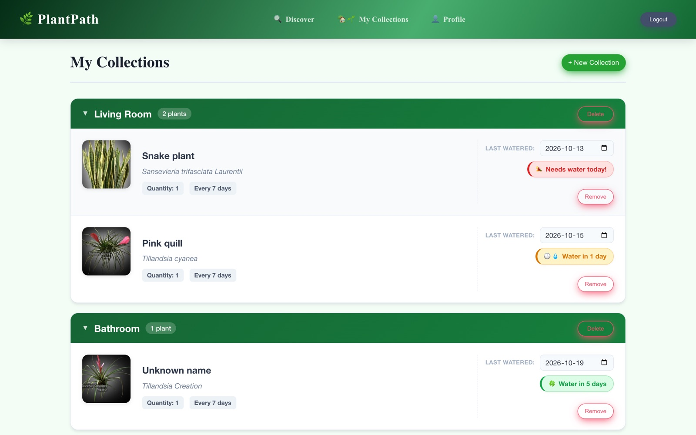
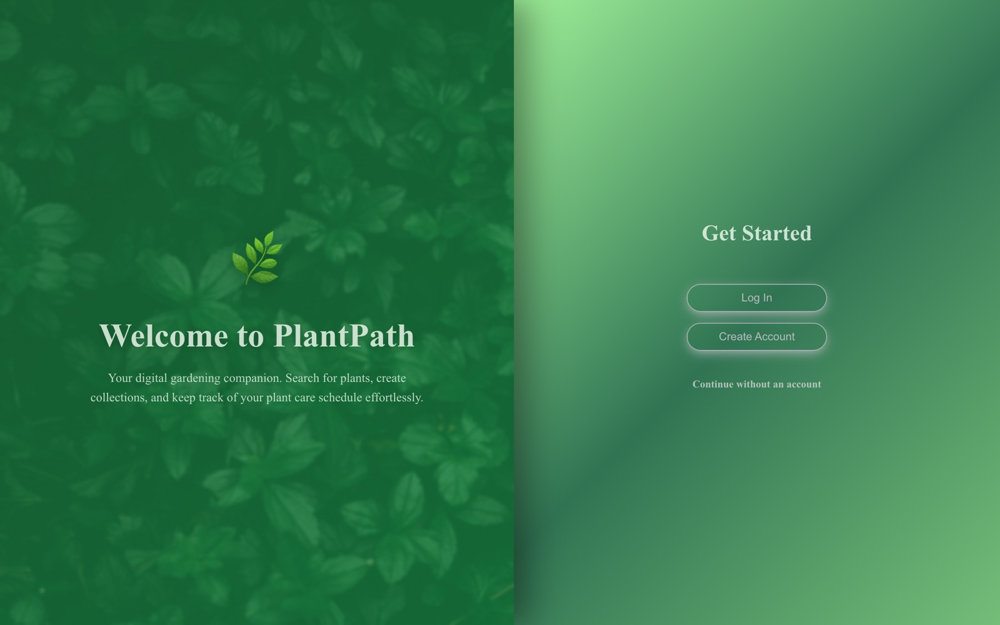
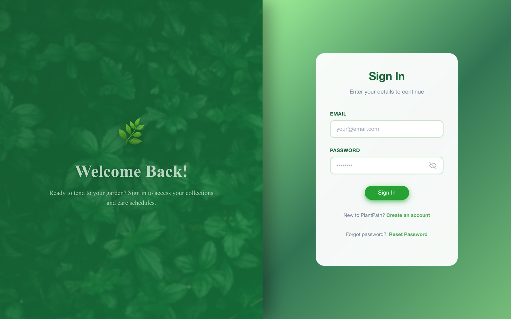
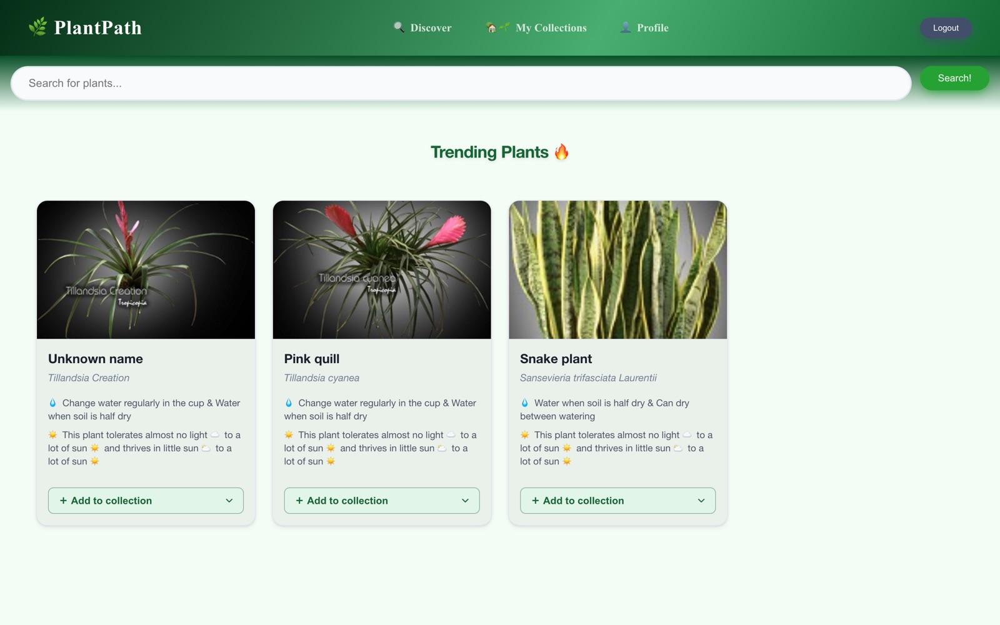
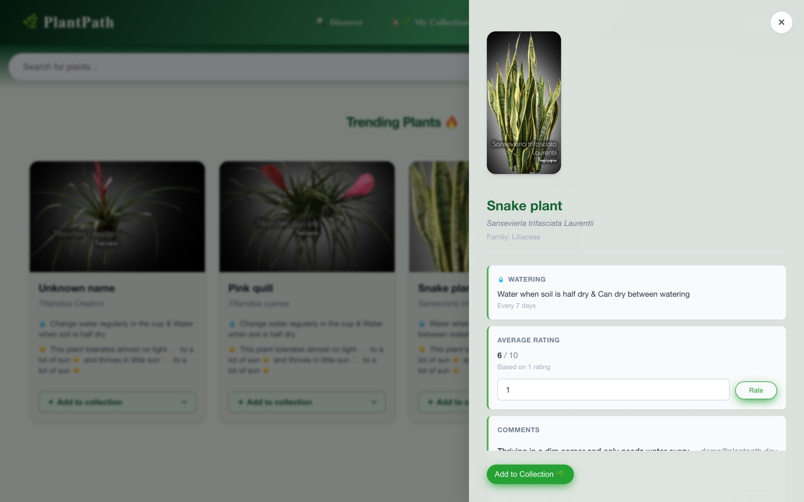
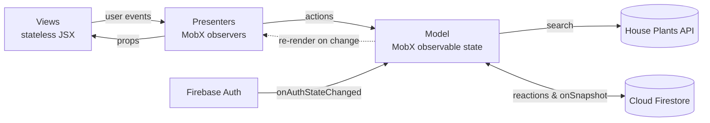

<div align="center">

# 🌿 PlantPath

**Discover houseplants, organise them into collections and never forget to water them again.**

**[🌐 Live demo](https://plantpath-bac3f.web.app)**

[](https://github.com/Sana8200/PlantPath/actions/workflows/build.yml)




</div>

## About

PlantPath is a single-page web app for houseplant owners. You can search a database of houseplants, read care instructions, save plants into your own collections, log when you water them and see at a glance which ones are thirsty. Ratings and comments are shared between all users, and the most-collected plants show up as **Trending**.

It was built with **React** and **MobX** using a strict **Model–View–Presenter** architecture, with **Firebase** for authentication and real-time persistence.

> [!NOTE]
> PlantPath was a group project at KTH, built between December 2025 and January 2026, and is no longer maintained. The [live demo](https://plantpath-bac3f.web.app) still runs, and you can create an account and sign in. Plant search no longer returns results, because the House Plants API subscription it used has ended. The screenshots below show the app as it worked.

## Features

**🪴 Collections and watering**
- Create as many named collections as you like ("Living Room", "Bedroom", …)
- Each plant gets a watering interval derived from its care data
- Log the last watering date and get a colour-coded status: **needs water today**, **soon** or **OK**
- Adding the same plant again increases its quantity instead of duplicating it

**🔍 Discovery**
- Search by common or Latin name through the [House Plants API](https://rapidapi.com/mnai01/api/house-plants2)
- A details panel with watering, light, pruning and family info. Raw lux ranges are turned into plain language ("thrives in little sun 🌥️ to a lot of sun ☀️")
- Trending plants ranked by how often users add them to a collection

**💬 Community**
- Rate plants from 1 to 10 (one rating per user per plant) and see the live average
- Leave comments that other users can read

**🔐 Accounts**
- Email/password sign-up, login and password reset with Firebase Auth
- Browse and search without an account. Log in to save collections, rate and comment.

## Screenshots

| Welcome | Sign in |
| :---: | :---: |
|  |  |
| **Discover & trending** | **Plant details** |
|  |  |

## Architecture

The app follows **Model–View–Presenter**. Views are plain components that only receive props and fire callbacks. Presenters are MobX `observer` components that read the model and pass data and handlers down. All state and business logic live in the model.



- **`PlantPathModel`** holds the signed-in user, collections, watering history and search state.
- **`MetaDataModel`** holds data shared by all users: scores, ratings and comments.
- **`Plant`** wraps raw API data and works out the watering interval, sun conditions and pruning advice.
- **`firebaseModel.js`** loads a user's data when they sign in, then uses MobX `reaction`s to write changes back automatically. A Firestore `onSnapshot` listener keeps trending scores live across users.

### Project structure

```
src/
├── api/          House Plants API calls and a promise-state helper
├── components/   Reusable UI (PlantCard, Button)
├── model/        MobX models, Plant class, Firebase config and persistence
├── reactjs/      Presenters, router and app entry point
├── services/     Firebase Auth wrapper with friendly error messages
├── style/        Per-view stylesheets sharing CSS custom properties
└── views/        Stateless view components
```

## Getting started

### Prerequisites

- [Node.js](https://nodejs.org/) 20.19 or newer
- A [Firebase](https://console.firebase.google.com/) project with **Email/Password authentication** and **Cloud Firestore** enabled
- A [RapidAPI](https://rapidapi.com/mnai01/api/house-plants2) key subscribed to the House Plants API

### Run locally

```bash
git clone https://github.com/Sana8200/PlantPath.git
cd PlantPath
npm install
cp .env.example .env   # then fill in your keys
npm run dev
```

The app runs at **http://localhost:8080**.

### Environment variables

| Variable | Description |
| --- | --- |
| `VITE_apiKey`, `VITE_authDomain`, `VITE_projectId`, `VITE_storageBucket`, `VITE_messagingSenderId`, `VITE_appId`, `VITE_measurementId` | Your Firebase web app config (*Project settings → Your apps*) |
| `VITE_HOUSEPLANTKEY` | RapidAPI key for the House Plants API |

### Scripts

| Command | Description |
| --- | --- |
| `npm run dev` | Start the Vite dev server |
| `npm run build` | Build for production into `dist/` |
| `npm run serve` | Preview the production build |
| `npm run deploy` | Build and deploy to Firebase Hosting (needs the [Firebase CLI](https://firebase.google.com/docs/cli)) |

## Tech stack

| | |
| --- | --- |
| **UI** | React 19, React Router 7 (hash routing) |
| **State** | MobX 6, mobx-react-lite |
| **Backend** | Firebase Authentication, Cloud Firestore, Firebase Hosting |
| **Data** | House Plants API via RapidAPI |
| **Tooling** | Vite 7 |
| **Styling** | Plain CSS with custom properties |

## Acknowledgements

- Plant data and images from the [House Plants API](https://rapidapi.com/mnai01/api/house-plants2) (images © [Tropicopia](https://www.tropicopia.com/))
- Built as a group project for [DH2642 Interaction Programming and the Dynamic Web](https://www.kth.se/student/kurser/kurs/DH2642) at KTH Royal Institute of Technology

## Author

**Sana Monhaseri** · [@Sana8200](https://github.com/Sana8200)

Questions about the code are welcome. Feel free to open an issue or reach out.

## License

This project is source-available for viewing only. See [LICENSE](LICENSE.md) for details.
